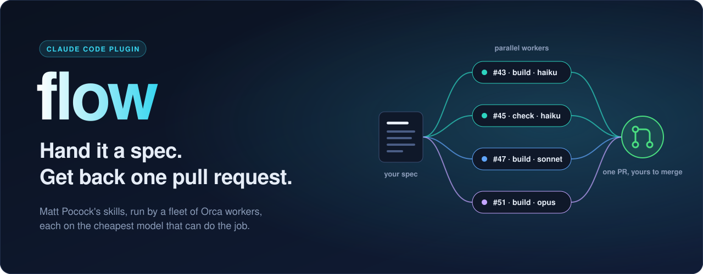
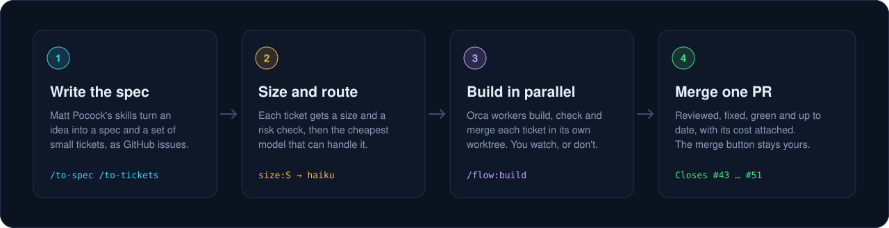
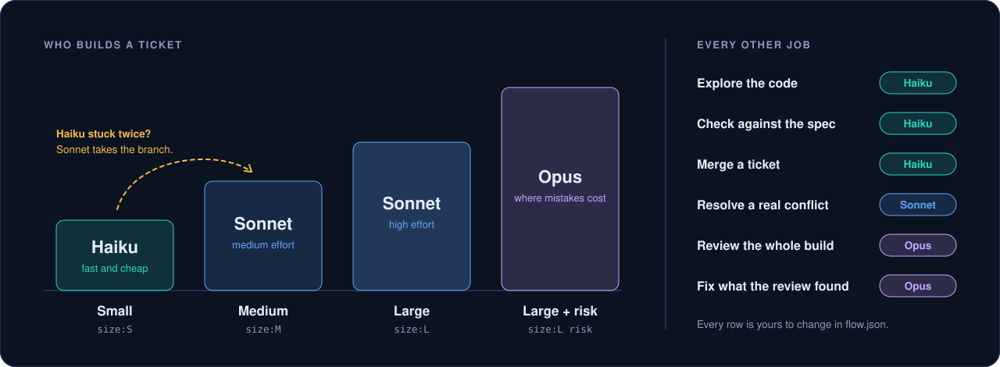
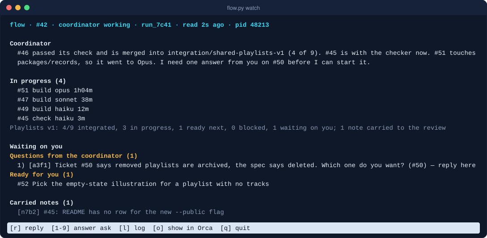
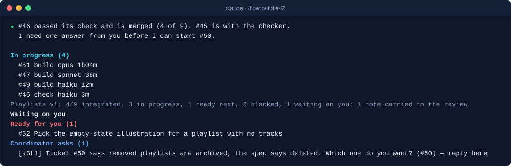
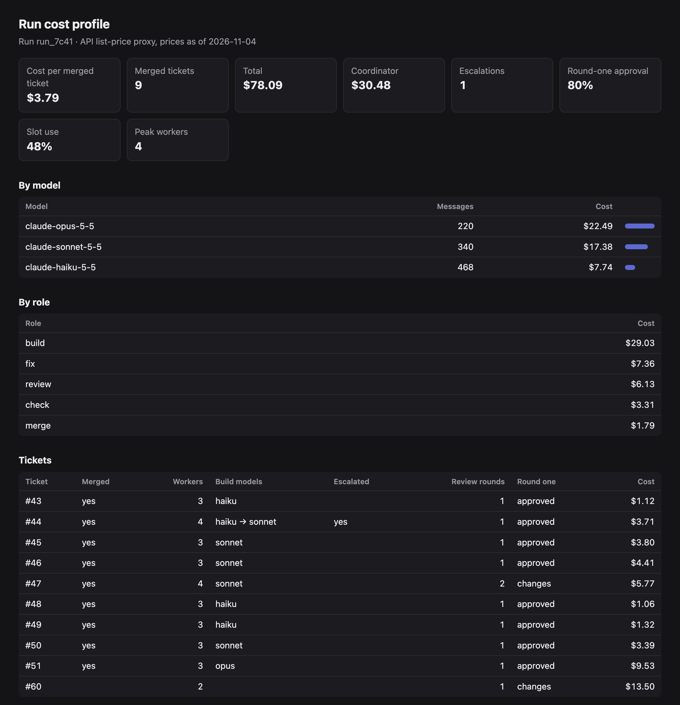
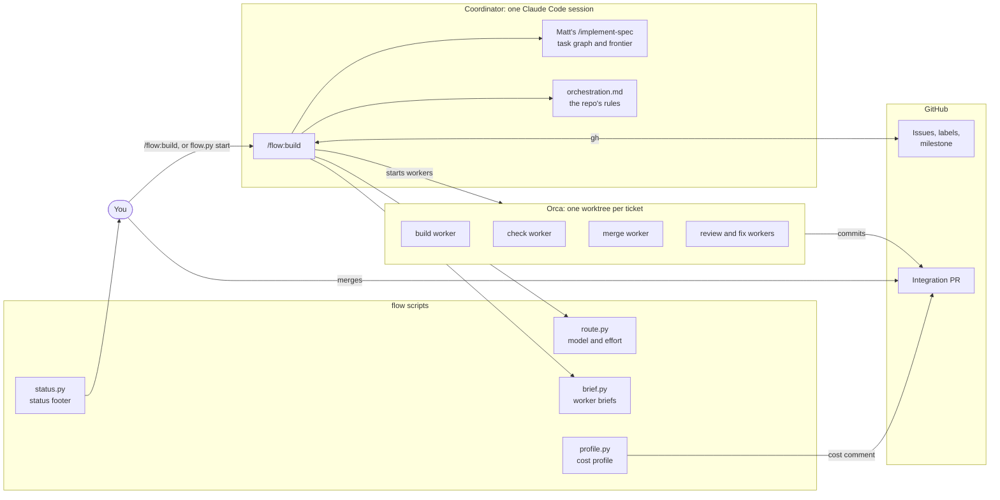
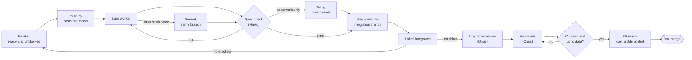

<p align="center">
  
</p>

<p align="center">
  <b>Build a whole spec while you do something else.</b><br>
  flow hands every ticket to its own AI worker, picks the cheapest model that can do it,<br>
  checks the work, and brings it all back as one pull request for you to merge.
</p>

<p align="center">
  <a href="#get-started"><b>Get started</b></a> ·
  <a href="#what-you-get">Features</a> ·
  <a href="#under-the-hood">Under the hood</a> ·
  <a href="CHANGELOG.md">Changelog</a>
</p>

<p align="center">
  
  
  
  
</p>

---

## What is flow?

flow is a [Claude Code](https://claude.com/claude-code) plugin that joins two tools that are each great alone:

| | What it is | What it brings |
| --- | --- | --- |
| **[Matt Pocock's skills](https://github.com/mattpocock/skills)** | A set of skills that teach Claude to work like a careful engineer: turn an idea into a spec, split the spec into small tickets, then build them. ([More](https://aihero.dev/skills)) | **The method.** What to build, and in what order. |
| **[Orca](https://orca.dev)** | An app that runs a fleet of coding agents side by side, each in its own copy of your repo. ([More](https://github.com/stablyai/orca)) | **The hands.** Many tickets built at once, none stepping on another. |
| **flow** | The part in the middle. | **The judgement.** Which model builds each ticket, what gets checked before it merges, what needs you, and what it all cost. |

You write the spec. You run one command. You merge one pull request.

<p align="center">
  
</p>

```
/plugin marketplace add shrujancheruku/orca-flow
/plugin install flow@orca-flow
```

Then [set up your repo](#get-started).

---

## What you get

### One command in, one pull request out

`/flow:build` takes a spec and builds every ticket in it. Tickets that don't depend on each other are built at the same time, each by its own worker in its own worktree. As each one passes its check it is merged into a single integration branch, and the next tickets it was blocking start on their own.

At the end there is **one** pull request. Its description closes every ticket. It has been reviewed, its findings fixed, its checks are green and it is up to date with `main`. Merging it is your call, always, unless you turn automerge on for that run.

### The right model for every job

Most tickets don't need your most expensive model. Some really do. flow decides ticket by ticket, so you stop paying Opus prices for a one-line fix and stop trusting Haiku with your migrations.

<p align="center">
  
</p>

- **Size decides the model.** Small tickets go to Haiku, medium and large to Sonnet, and the big risky ones to Opus.
- **Risk raises it.** Tell flow which paths are costly to get wrong (auth, migrations, billing). A ticket that touches one is moved up a model, even when it only names a file or a function that lives there.
- **A stuck worker is replaced, not retried forever.** A Haiku worker that fails twice hands its branch to Sonnet. A second failure comes to you.
- **Your table, your rules.** Change any row in one line of `flow.json`. Rows you haven't touched keep improving with each release.
- **Not only Claude.** A row can run on Codex, OpenCode or any other agent Orca knows.

### Sizes you don't have to guess

Routing is only as good as the sizes on your tickets, so flow sizes them for you. `/flow:setup` reads every open ticket, proposes `S`, `M` or `L`, and waits for your approval before it labels anything.

It doesn't ask the model "how hard does this feel?". It asks how many lines the change will take, which is a question with a right answer. Scored against 69 closed tickets from a real project, it picked the exact size **78% of the time** (a rubric-style prompt managed 52%), and it found 17 of the 23 changes that touched risky code.

Want proof on your own repo? `estimate.py backtest` scores the estimator against tickets you have already shipped.

### A console for your terminal

Start a build and watch it from any terminal, with no Claude Code session open. See who is working on what, how far the milestone is, and exactly what is waiting on you.

<p align="center">
  
</p>

- **Answer in one key.** The coordinator's questions are numbered. Press `1` and type your answer.
- **Close it whenever.** The build runs in Orca, not in the console. Quit, go to lunch, reopen it with `flow.py watch`.
- **Slow workers are flagged.** A worker with no heartbeat, or one taking three times as long as its peers, is called out.
- **Easy on GitHub.** The console, the footer and the router share one cache and slow down by themselves as your rate limit runs low, so watching a build never stalls it.

### Always know what's waiting on you

Prefer to stay in Claude Code? Every coordinator turn ends with the same status footer: what is in progress, how far along the milestone is, and a short list of the things only you can do. You never have to ask "where are we?".

<p align="center">
  
</p>

When nothing needs you, it says so: `Waiting on you: nothing`.

### See where every dollar went

When the build is done, flow comments a cost summary on the pull request and writes a full report: cost per merged ticket, by model, by role and by ticket, plus which tickets escalated and how many passed review first time.

<p align="center">
  
</p>

This is how you tune the routing table with evidence instead of instinct. Costs are priced at API list prices, so on a subscription they are a yardstick for comparing runs, not a bill.

### Quality gates at every step

Fast is worthless if you have to redo it. Nothing reaches your pull request unchecked.

| Gate | When | What it does |
| --- | --- | --- |
| **Spec check** | Before each ticket merges | A separate worker checks the work against the ticket's acceptance criteria. A fail goes back to the implementer. |
| **Integration review** | Once, on the whole build | Opus reviews everything together and catches what per-ticket checks can't see. |
| **Fix rounds** | After the review | Each finding is fixed, and every behaviour fix ships with a test. |
| **Green before ready** | Before you are asked to merge | CI has passed on the final commit and the branch is up to date with its base. |

### Safe by default

- **You hold the merge button.** flow never merges to `main` unless you turn automerge on for that run.
- **Dry run first.** Every script that changes your repo or GitHub only shows what it would do until you pass `--apply`, and is safe to run twice.
- **Matt's skills stay untouched.** flow never edits them. It adds its own clearly marked sections to your docs, and rewrites only those.
- **Nothing is forced.** No force pushes, no deleted branches. Cleanup keeps any worktree that still has unsaved work, and tells you which.
- **Nothing to install.** Python standard library only. No packages, no build step, no service to run.

### And the rest

| | |
| --- | --- |
| **Guided setup** | `/flow:setup` writes the config, creates the labels, seeds the docs and proposes sizes. A wizard walks you through the few steps only you can do. |
| **Workers that start informed** | Every worker starts from a short brief written for its role, carrying the lessons earlier builds paid for. Add your repo's own rules in a file. |
| **Milestones** | Build a big spec one GitHub Milestone at a time, each with its own integration branch and pull request. |
| **Linear** | Prefer Linear, or moving to it from GitHub? There is an [adapter](adapters/linear/README.md), with a migration. |
| **Tidy endings** | Once the pull request merges, the build's worktrees are cleaned up for you. |

<p align="center"><sub>The console, footer and cost profile above show a sample build, drawn by the plugin's own code.</sub></p>

---

## Get started

**You need** [Claude Code](https://claude.com/claude-code), [Orca](https://orca.dev), the GitHub CLI (`gh`), Python 3.9+ and [Matt Pocock's skills](https://github.com/mattpocock/skills).

**1. Install the plugin**

```
/plugin marketplace add shrujancheruku/orca-flow
/plugin install flow@orca-flow
```

**2. Set up your repo** (once per repo, from inside it)

```
/setup-matt-pocock-skills      # if you haven't: pick GitHub, keep the default triage labels
/flow:setup                    # config, labels, docs and size proposals
```

Then run `wizard/wizard.sh` from the plugin's folder in your own terminal. It imports the repo into Orca and sets up Slack notifications.

**3. Build something**

```
/flow:build <spec issue>
```

Or from a plain terminal, with the console:

```
python3 <plugin>/scripts/flow.py start <spec issue> --apply
```

That's it. Go do something else; flow will tell you when it needs you.

---

## Under the hood

Everything below is reference: how flow is put together and what every script does.

### Architecture

flow is a thin policy layer. The procedure is Matt's, the execution is Orca's, the record is GitHub's.



| Layer | What | Where |
| --- | --- | --- |
| Procedure | Matt's `/implement-spec`: a task graph, a frontier, one integration branch | Matt's plugin, unmodified |
| Policy | `/flow:build`: how each role is run, routed, checked and merged | `skills/build`, `docs/agents/orchestration.md` |
| Executor | Orca: each role is a worker in its own worktree | `orca` |
| Measurement | The profiler: cost by model, role and ticket | `scripts/profile.py` |

Matt's skills are used as published. This plugin never edits them. It changes their behaviour only through the docs it seeds into your repo (`docs/agents/*.md`, between its own `<!-- flow:begin ... -->` markers) and the `## Agent skills` block in `CLAUDE.md`.

GitHub Issues is the tracker. Linear is an optional adapter ([`adapters/linear/`](adapters/linear/README.md)), for a team that wants Linear or a repo moving from GitHub to Linear.

### The life of a ticket



### What you get, by command

- `/flow:setup` sets up a repo: config, labels, seeded docs and size proposals.
- `/flow:build` builds a spec. It follows `/implement-spec`, runs each role as an Orca worker, and picks each worker's model from a routing table: the plugin's defaults, with the rows you set in `docs/agents/flow.json`.
- `wizard/wizard.sh` walks you through the steps only you can do: importing the repo into Orca, the GitHub Slack app, and updating Matt's plugin.

### Model routing

The defaults live in the plugin (`flowlib/routing.py`), so a new release changes every row you have not set. To set a row, name it under `routing` in `docs/agents/flow.json` (`"routing": {"fix": {"model": "sonnet", "effort": "medium"}}`). `route.py` routes from the two on every dispatch. Your repo's `docs/agents/orchestration.md` holds a copy of the result between the plugin's markers; `seed_docs.py --apply` rewrites it, `/flow:build` runs that at the start of each build, and `route.py` warns when the copy is out of date. Size comes from the `size:S|M|L` label. The `risk` label, or a ticket that names a path in `risk_paths`, raises the model. A ticket names a risk path when it writes the path out, names a file under it (`identity/service.go` is enough, and a new file counts by its directory), or names code that mostly lives under it. A one-word directory like `config/**` counts only as the start of a path, so the word "config" alone doesn't. `route.py` and `estimate.py` look names up in the checked-out repo, so run them from it.

| Role | Model | Effort |
| --- | --- | --- |
| Implementer, S | Haiku | |
| Implementer, M | Sonnet | medium |
| Implementer, L | Sonnet | high |
| Implementer, L + risk | Opus | |
| Scout | Haiku | |
| Merger | Haiku | (Sonnet, medium, on a real conflict) |
| Per-ticket check | Haiku | |
| Integration review | Opus | |
| Fixer | Opus | |
| Coordinator | Opus | medium |

One escalation: a Haiku implementer that fails twice is replaced by Sonnet on the same branch. S + risk and M + risk have rows too; see the seeded table. Haiku takes no effort setting: Orca refuses a worker started with one, so `route.py` never passes `--effort` for it.

### How work maps to GitHub

| Matt's skills / flow | GitHub |
| --- | --- |
| A spec | An issue |
| A ticket | An issue, linked to the spec |
| Blocked by | Native issue dependencies (or a `Blocked by:` line) |
| The five triage roles | Labels `needs-triage`, `needs-info`, `ready-for-agent`, `ready-for-human`, `wontfix` (Matt's setup skill makes them) |
| A build milestone | A GitHub **Milestone** |
| The milestone's build | One integration branch and one draft PR into main |
| A ticket merged into the integration branch | The `integrated` label. The issue stays open; the frontier counts it as done. |
| Closing tickets | `Closes #N` lines in the integration PR body: the founder merges it, GitHub closes them |
| Size and risk | Labels `size:S`, `size:M`, `size:L`, `risk` |
| A worker | An Orca worktree created with `--issue <n>`, task title `#123 · build · haiku` |
| The end-of-milestone cost summary | A comment on the integration PR |

The founder merges integration PRs. Automerge is opt-in per run.

### From a terminal

`flow.py` runs a build without a Claude Code session open: it starts the coordinator in Orca and gives you a console in your own terminal. From the repo:

```
python3 <plugin>/scripts/flow.py start 19            # dry run: the launch and the prompt
python3 <plugin>/scripts/flow.py start 19 --apply    # launch, then open the console
python3 <plugin>/scripts/flow.py watch               # reopen the console on the running build
```

`<plugin>` is the installed plugin's folder (`claude plugin list`), or a checkout of this repo. The coordinator is a Claude agent in an Orca terminal of the repo (`orca agent launch --surface terminal`), so Orca wakes it with its workers' mail as usual, and it keeps going when you quit the console. The console shows the coordinator's state and last message, the live workers and the milestone's tally, what waits on you (the coordinator's asks numbered first and shown in full, wrapped to the terminal's width, then the status footer's other sections) and the carried notes, refreshed every five seconds (GitHub at most once a minute: see "GitHub's rate limit"). `r` replies to the coordinator, `1`-`9` answers that ask, `l` reads its recent conversation, `o` brings its terminal to the front in Orca (where you answer a permission prompt; the console flags a coordinator Orca reports as blocked), `q` quits. A reply is typed into the coordinator's prompt as your own input, so "automerge on" said there counts as yours. `--milestone`, `--model`, `--effort` and `--automerge` shape the launch; `watch --once` prints one frame and exits.

The header shows the console's pid. Stopped and continued (Ctrl+Z then `fg`), it repaints, reads at once and says how long it was paused. Quit it with `q`; never pause or kill it, or the coordinator, on the founder's behalf without asking.

### GitHub's rate limit

GitHub allows 5,000 GraphQL points an hour, and the coordinator, its workers, the status footer, `route.py` and the console all draw on them. The footer, `route.py --lookup` and the console share one cache, `<git common dir>/flow/github-cache.json` (`$FLOW_GITHUB_CACHE`). An answer under a minute old is reused by any of them. Every footer query asks GitHub what it cost and what is left (`rateLimit`). Below 20% left, answers are reused five times as long. Below 5%, GitHub is not asked again until the hour resets, and the footer says "GitHub paused until HH:MM" while still showing its last answer. A rate-limit error pauses the same way. A secondary rate limit (too many requests too fast) is retried with backoff, honouring Retry-After when gh passes it on. `route.py --lookup` falls back to REST, which has its own limit, and then to the last answer it kept. When it still cannot read the ticket it exits 75; `--wait` blocks until it can route.

### Briefs

Every worker starts from a brief, and `brief.py` writes it: one short template per role in `templates/briefs/`, made of context pointers (the ticket URL, the policy doc, the branches), not a restatement of the ticket. The templates hold the rules earlier runs paid for: the build brief ends in a resolution comment with the verbatim last lines of each verify command; the check is read-only and reports FAIL and FIX-FORWARD; the merge regenerates a generated file and stops on a conflict outside the shared and generated files; the review treats carried notes as leads to confirm; the fix ships a test per behaviour fix. A repo adds its own rules in `docs/agents/briefs/<role>.md`, appended after the template, and the coordinator adds ticket-specific text with `--extra`.

```
python3 scripts/brief.py --role build --ticket 22 --integration-branch integration/m | orca orchestration worker-start ... --spec-file -
```

### Config

Every per-repo value is in `docs/agents/flow.json`: `tracker`, `github_repo`, the label names, `risk_paths`, `generated_paths` and `size_lines` (for the backtest), `slack_prefix`, the model aliases and `status` (when the status footer calls a worker slow). The schema is `schema/flow.schema.json`; `examples/flow.json` is a filled one. Scripts look for the config at `--config`, then `$FLOW_CONFIG`, then `docs/agents/flow.json`. `--repo owner/name` stands in for a missing config.

### Scripts

All in `scripts/`. Each that writes is a dry run until you pass `--apply`, and each is safe to rerun. `notes.py --add/--done`, `status.py --ask/--done` and `flow.py watch` are exempt: they write only the local bookkeeping files under `<git common dir>/flow/` (`notes.jsonl`, `asks.jsonl`, `console.json`, and the GitHub cache `github-cache.json` that reads keep), never the repo's tracked files or GitHub, so they need no `--apply`.

| Script | Does |
| --- | --- |
| `setup_labels.py` | Creates `size:S`, `size:M`, `size:L`, `risk` and `integrated` with `gh label create`. Checks Matt's five triage labels exist and reports any that do not; it creates none of them. |
| `seed_docs.py` | Adds an "Orca and milestones" section to `issue-tracker.md`, a "Flow labels" section to `triage-labels.md`, writes `orchestration.md` if absent, and adds the Orchestration block to `CLAUDE.md`. Only the text between its markers is rewritten, which in `orchestration.md` is the routing table. Rerun it after a plugin release. A routing table kept by hand before 0.7.0 is handed over on the first run: rows that differ from every default the plugin has shipped move to `routing` in `flow.json`. |
| `estimate.py` | `propose` copies existing `size:` labels, asks Haiku (through `flowlib/agents.py`: `claude -p --model haiku --output-format json`) to double-check them and to size the rest, and writes a file for you to approve. `apply --apply` edits only the approved ones, with `gh issue edit --add-label`. |
| `estimate.py backtest` | Sizes closed tickets the way `propose` does and scores the answers against what each one's merged PR changed (`generated_paths` left out, cut at `size_lines`), next to the size labels those tickets had. Answers are cached by prompt, so after a rubric change a rerun asks only again where the prompt changed. `--style lines` asks for expected changed lines instead of a size (cut at `size_lines`); `--style rubric` is the original prompt. `--split dev|test` holds out a fixed quarter of tickets, `--closed-after` scores only recent ones, and `--samples N` takes the median of N estimates, `--style examples` adds similar closed tickets with their real sizes to the prompt, and `--style facts` adds the repo's counts for the paths and names the ticket mentions. Both are opt-in; neither beat `lines` on Issho. Other PRs that mentioned a ticket count toward its size, and deleted files don't. `--no-model` scores the labels alone. Writes nothing to GitHub. |
| `route.py` | Picks a worker's model and effort from the plugin's defaults and your `routing` rows, and prints its task title. `--lookup` reads the ticket's labels through the shared GitHub cache, then REST, then the last answer kept; it exits 75 when none answers, and `--wait` (up to `--wait-max` minutes, 90) blocks until it can route. |
| `cleanup.py` | Removes a finished run's worktrees with `git worktree remove`, after the integration PR merges. Keeps and names any with uncommitted files or a HEAD on no remote branch; never forces; branches stay. `orca worktree rm` is not used: it hangs and leaves the checkout behind. |
| `status.py` | The status footer `/flow:build` prints at the end of every coordinator turn (`--plain`; `--json` for the same data). **In progress**: each live worker of the run (ticket, role, model, time since its task was created), flagged when it has no heartbeat, exited without reporting, or has run past `status.slow_factor` (3) times its role's median in the run (`status.slow_minutes`, 120, with fewer than 3 finished), then the milestone's tally: integrated, in progress, ready next, blocked, waiting on you, and the count of workers on the integration PR (review, fix, merge) or outside the tickets. **Waiting on you**, in this order and each left out when empty: `ready-for-human` tickets in the milestone, those outside it, `needs-info` tickets, the coordinator's asks, worker questions and escalations Orca has not marked handled (and pending gates), and the integration PR once it is out of draft or every milestone ticket is integrated, with its check counts ("ready for you to merge" only when no check is red or pending and the branch is neither behind nor in conflict with its base); else `Waiting on you: nothing`. `--ask "<text>" [--ticket <n>] [--where <text>]` records an ask and prints its id, `--done <id>` clears it; an ask whose issue or PR closed is dropped. Asks live in `<git common dir>/flow/asks.jsonl` (inside `.git`, so never tracked and shared by every worktree; mode 0600), or `$FLOW_ASKS_FILE`. Reads only: five `orca` reads and one or two label-, milestone- or number-filtered GraphQL reads, through the shared GitHub cache (see "GitHub's rate limit"); `github-cache.json` is the cache's own bookkeeping file. Whatever it cannot read is named on one `Unavailable:` line, and it exits 0. "Handled" is Orca's flag on a message; the footer cannot tell whether the coordinator answered it, only whether Orca marked it handled. Blockers are GitHub's native issue dependencies, not `Blocked by:` lines. GitHub Issues only. |
| `notes.py` | The notes the coordinator carries from a ticket's merge to the integration review: a check that failed only on paperwork and was ruled accepted ("Rulings" in the build skill). `--add "<text>" --ticket <n|ABC-123>` records one (a GitHub number or a Linear ID) and prints its id, `--done <id>` clears it, no flag lists the live notes oldest first with their ticket, `--markdown` prints them grouped by ticket for the review brief (nothing, exit 0, when none). Notes live in `<git common dir>/flow/notes.jsonl` (inside `.git`, so never tracked and shared by every worktree; mode 0600), or `$FLOW_NOTES_FILE`, append-only like the asks. Printed text has control characters and bidi overrides stripped. The status footer's tally line shows `; N notes carried to the review` when there are any. `--done` with an unknown id exits 1. |
| `brief.py` | Prints a worker's brief from `templates/briefs/<role>.md` (`build`, `check`, `merge`, `review`, `fix`) for `worker-start --spec-file -`. `--role` and `--ticket` (the integration PR's number for `review` and `fix`, or `--pr <n>` when `--ticket` is something else) with `--integration-branch`; `--branch`, `--tip`, `--round`, `--base` and `--ticket-url` where the role needs them. It fills the repo from the config, reads nothing from GitHub or Orca and writes nothing; a missing required value is an error naming the flag. `--ticket` takes a Linear ID (`ABC-7`) for `build`, `check` and `merge`, with `--ticket-url` required (an error names it); the brief then names it without a `#` and points the worker at the URL instead of `gh issue view`. `notes.py` in the review and fix briefs is the plugin's own path, filled by `brief.py`. `--extra <file>` (or `-`) appends ticket-specific text and is required for `review` (the output of `notes.py --markdown`; an empty file renders "No carried notes"), and the repo's own `docs/agents/briefs/<role>.md` is appended after the template. See "Briefs". |
| `flow.py` | Runs `/flow:build` from a normal terminal (see "From a terminal"). `start <spec>` prints the `orca agent launch` it would make and the coordinator's prompt; `--apply` launches it, records it in `<git common dir>/flow/console.json` (mode 0600; `$FLOW_CONSOLE_FILE`) and opens the console, and a rerun while that coordinator's terminal is connected launches nothing. The prompt has the coordinator create its run with the objective `flow:build <spec>`, which is how the console finds the run from another terminal. `watch` opens the curses console (`--once`, or no TTY, prints one frame). It reads with `orca terminal show`, `agent list`, `agent read`, `orchestration run-list` and the status footer's reads, and writes only `orca terminal send` (your replies) and `terminal switch`. |
| `profile.py` | Costs an Orca run by model, role and ticket. Writes JSON and an HTML view. `--coordinator <transcript>` takes every coordinator session of the run (repeat the flag, or list several paths); a message in more than one transcript counts once, and a transcript named twice, in any spelling, is one session. `--pr <n> --apply` comments the summary on the integration PR. |

### Requirements

- Python 3.9+ (standard library only), `gh`, `orca` and `claude`.
- Matt Pocock's skills plugin, set up in the repo with `/setup-matt-pocock-skills`.

### Tests

```
python3 -m unittest
```

### Releases

See [`CHANGELOG.md`](CHANGELOG.md). Versions follow [Semantic Versioning](https://semver.org/).

## License

MIT
